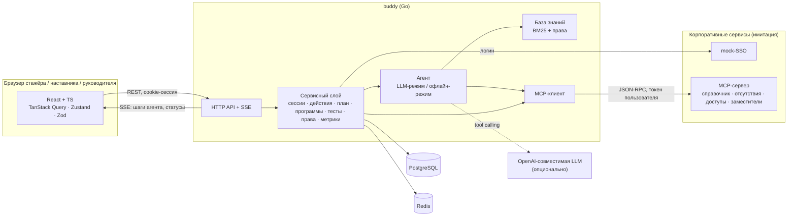
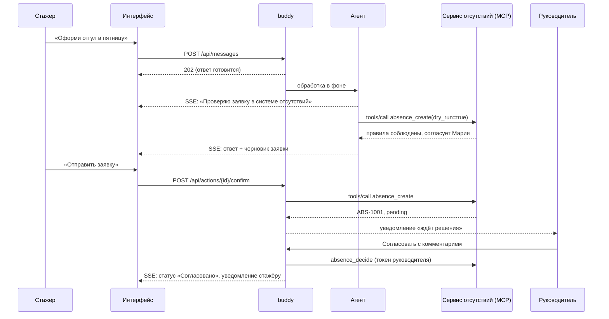

# Архитектура



## Каналы: агент не привязан к интерфейсу
Логика AI-buddy — агент, сервисный слой, права, действия — находится за HTTP API. Веб-интерфейс лишь один из клиентов:

| Канал | Статус | Как устроен |
|---|---|---|
| Веб-приложение | готово | React-клиент API |
| Приложение на телефоне (PWA) | готово | Тот же клиент: устанавливается с главного экрана, ярлыки «Мой план» и «Заявки», оболочка открывается без сети. Данные API не кэшируются на устройстве |
| Бот в корпоративном мессенджере | развитие | Ещё один клиент того же API: сообщения → `POST /api/messages`, обновления из `events.Hub` → сообщения в мессенджер. Авторизация — корпоративная, не через учётную запись мессенджера |

Публичные мессенджеры (например, Telegram) сознательно не используются: данные о сотрудниках, заявках и доступах не должны покидать контур компании, а учётная запись мессенджера не совпадает с корпоративной.

## Поток «вопрос → результат»


## Обучение и управление содержимым
- **Записи** (`records`, миграция `003_docs.sql`): инструкции и папки команды, тесты и попытки, шаблоны обучения, программы стажёров, выданные права — JSON-документы с ключом (вид, id). Новые виды не требуют миграций.
- **Программа стажёра** — копия шаблона. План строится по программе; отметки шагов хранятся по id шага, поэтому смена шаблона сохраняет совпадающие отметки, а правка шаблона не ломает текущие программы.
- **Шаг закрывается сам** по выданному доступу (`auto.access`) или по сданному тесту (`quiz`).
- **Инструкции команды** пишутся в интерфейсе и сразу переиндексируются (`knowledge.Base.Upsert`); при старте поднимаются из хранилища.
- **Согласование заместителем** проверяет сервис заявок (`delegation_set`, `mayDecide`), а не AI-buddy: право хранится там же, где заявки.

## Структура репозитория
```
backend/
  cmd/buddy          — сервис AI-buddy
  cmd/corpmock       — имитация корпоративных сервисов (MCP + SSO)
  internal/agent     — агент: LLM-режим, офлайн-режим, промпт
  internal/api       — HTTP API, SSE, статика, e2e-тесты API
  internal/app       — сервисный слой
  internal/corp      — правила и данные имитаций, MCP-инструменты
  internal/knowledge — база знаний (docs/*.md) и поиск
  internal/onboarding— шаблоны обучения (чек-лист Авито: разработчик, аналитик)
  internal/quiz      — тесты: проверка, разбор, встроенные тесты
  internal/mcp       — MCP: сервер и клиент
  internal/store     — PostgreSQL / память, миграции
  internal/kv        — Redis / память: сессии, rate limit
  internal/llm       — клиент OpenAI-совместимого API
web/                 — интерфейс (React + TS)
specs/, .specify/    — SDD-спецификации
e2e/demo.mjs         — сквозной сценарий и запись видео
```
